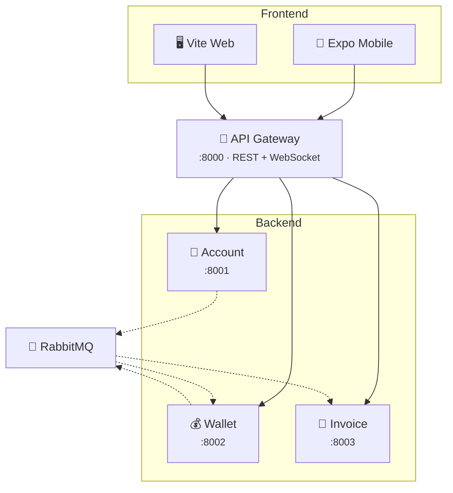

# FinVault

**A full-stack fintech banking platform** — Expo mobile app, React web dashboard, and event-driven Node.js microservices.

[](docs/architecture.md)
[](docs/architecture.md)
[](docs/architecture.md)
[](docs/ci-cd.md)
[](docs/deployment-strategy.md)

---

## Architecture



---

## Features

| Category | What's included |
|---|---|
| **Banking** | Multi-wallet (checking/savings/travel), P2P transfers (email + IBAN), SEPA transfers, deposits |
| **Cards** | Physical + virtual cards, freeze/unfreeze, spending limits, contactless/foreign/ATM controls |
| **Payments** | Scheduled & recurring payments, QR scan-to-pay (EPC069-12), payment requests, direct debits |
| **Savings** | Goals with funding + progress, round-up savings, date-based targets |
| **Insights** | Spend by category, monthly cash flow, balance trends, monthly budgets with alerts |
| **FX** | Currency exchange across 10 currencies with live rate display |
| **Security** | Biometric login, JWT rotation with replay detection, password management, session control, audit logs |
| **Notifications** | Persistent notification center with unread badges and read state |
| **Disputes** | Report transactions, track dispute status |
| **Export** | CSV download (web) and native share sheet (mobile) |
| **Theming** | Dark/light modes, 6 accent palettes, 7 presets, full theme engines on both apps |

---

## Tech Stack

| Layer | Technology |
|---|---|
| Mobile | Expo SDK 54 · React Native 0.81 · TypeScript |
| Web | Vite · React 18 · React Router · TypeScript |
| Backend | Express · Prisma · SQLite · TypeScript (ESM) |
| Auth | JWT · bcrypt · sha256 refresh tokens |
| Messaging | RabbitMQ (AMQP) · WebSocket |
| Rate Limiting | Redis (ioredis) with in-memory fallback |
| Testing | Vitest · 71+ tests across 13 files |
| CI/CD | GitHub Actions · EAS Build |

---

## Quick Start

### Prerequisites

- Node.js v18+
- (Optional) Docker for RabbitMQ

### Install & Run

```bash
# Install all workspaces
npm install

# Push database schemas
npx prisma db push --schema=services/account-service/prisma/schema.prisma
npx prisma db push --schema=services/wallet-transaction-service/prisma/schema.prisma
npx prisma db push --schema=services/invoice-service/prisma/schema.prisma

# Start everything (gateway + 3 services + web dashboard)
npm run dev

# Or include the mobile app
npm run dev:all
```

### Test Accounts

| Account | Email | Password |
|---|---|---|
| Business / Admin | `admin@finvault.com` | `admin123` |
| Personal / Consumer | `test@finvault.com` | `test123` |

> Both apps fall back to a client-side demo mode when the backend is unreachable.

### Run Tests

```bash
npx vitest run       # 71+ tests across 13 files
npm run build        # Typecheck + build all workspaces
```

---

## Service URLs

| Service | URL | Purpose |
|---|---|---|
| Web Dashboard | http://localhost:3000 | React SPA |
| API Gateway | http://localhost:8000 | REST + WebSocket entry point |
| Account Service | http://localhost:8001 | Auth, users, sessions |
| Wallet Service | http://localhost:8002 | Ledger, transfers, cards, goals |
| Invoice Service | http://localhost:8003 | Receipts, payment requests, mandates |
| RabbitMQ | http://localhost:15672 | Management UI (Docker only) |

---

## Mobile App

### Expo Go (development)

```bash
npm run dev:mobile    # Opens Expo Go
```

Expo Go is fine for day-to-day UI work, but remote push notifications are not available there anymore. To test push delivery, use an EAS development build or a standalone build from the EAS section below.

### EAS Build (standalone)

```bash
cd apps/mobile
npx eas build --profile preview --platform android     # Sideloadable APK
npx eas build --profile production --platform android   # Signed AAB
```

See [docs/deployment-strategy.md](docs/deployment-strategy.md) for the full deployment guide.

---

## Docker

```bash
docker-compose up --build -d    # RabbitMQ + all services
```

---

## Documentation

| Document | Contents |
|---|---|
| [docs/architecture.md](docs/architecture.md) | System design, data models, API endpoints, event flow |
| [docs/security.md](docs/security.md) | Auth flows, token lifecycle, rate limiting, threat model |
| [docs/design-system.md](docs/design-system.md) | Tokens, components, motion library, theming, a11y |
| [docs/ci-cd.md](docs/ci-cd.md) | GitHub Actions pipelines, branch protection |
| [docs/feature-roadmap.md](docs/feature-roadmap.md) | Feature matrix, comparison vs. Revolut/N26 |
| [docs/deployment-strategy.md](docs/deployment-strategy.md) | EAS Build, Docker, Play Store |
| [CLAUDE.md](CLAUDE.md) | Agent rules, codebase map, conventions |
| [TODO.md](TODO.md) | Task tracking & progress |

---

## Project Structure

```
FinVault/
├── apps/
│   ├── mobile/                     # Expo (React Native) mobile app
│   │   ├── src/components/         # UI primitives, Motion, Shell, FVLogo
│   │   ├── src/screens/            # 17 screens (Overview → Disputes)
│   │   └── src/lib/                # EPC QR, CSV, validation
│   └── web-dashboard/              # Vite + React 18 SPA
│       ├── src/components/         # Shell, UI, Icons, BankCard
│       ├── src/screens/            # 18 screens (Landing → SecurityCenter)
│       └── src/lib/                # Session, EPC, CSV, validation
├── services/
│   ├── gateway/                    # API proxy + WebSocket + Event Hub
│   ├── account-service/            # Auth, users, sessions, audit
│   ├── wallet-transaction-service/ # Wallets, transactions, cards, goals, FX
│   └── invoice-service/            # Receipts, payment requests, mandates
├── shared/                         # Auth, validation, events, integrity
├── docs/                           # Architecture, security, design, CI/CD
└── .github/workflows/              # 6 CI/CD pipelines
```

---

<p align="center">
  <strong>Built by <a href="https://github.com/Tombomeke-Studios">Tombomeke Studios</a></strong>
</p>
