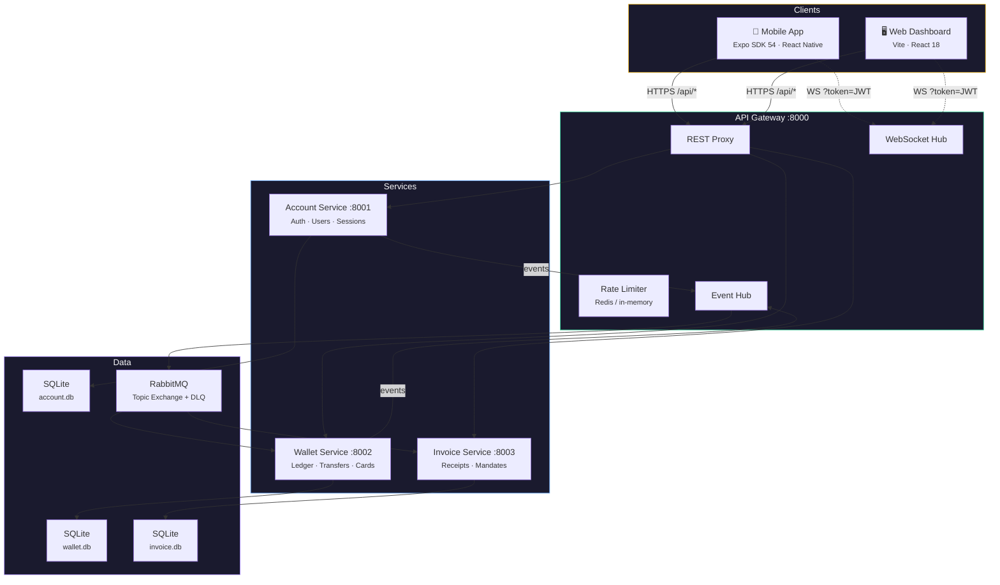
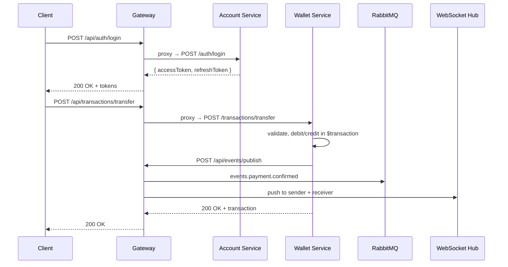
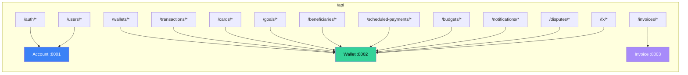
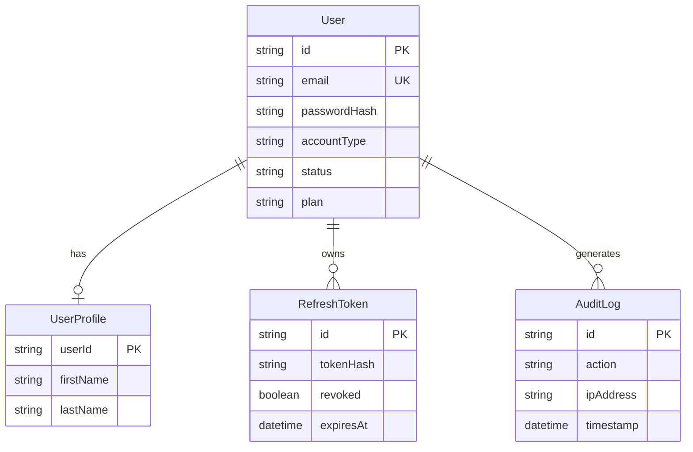
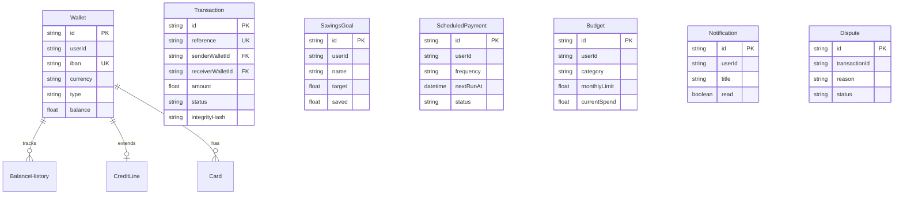
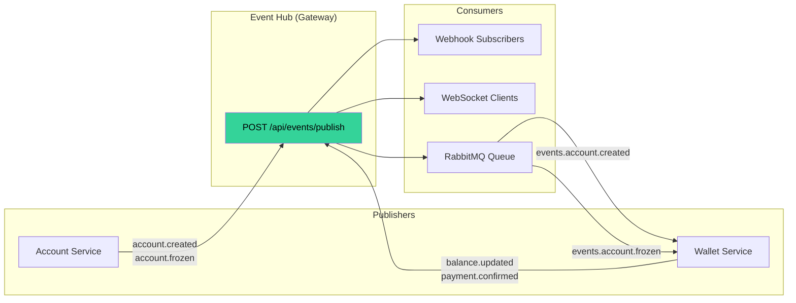
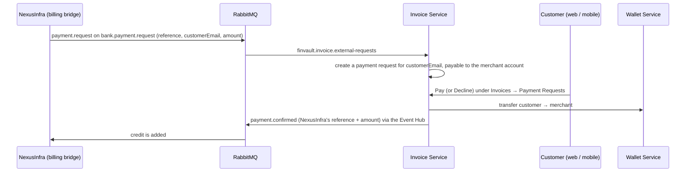

# FinVault Architecture

> Last updated: 2026-06-21 · v2.0.0

FinVault is a fintech banking platform built as an npm workspaces monorepo with two frontends and an event-driven microservices backend.

---

## System Overview

---

## Request Flow

---

## Gateway Routes

---

## Data Models

### Account Service

### Wallet Service

---

## Service Responsibilities

### Account Service `:8001`

| Endpoint | Method | Purpose |
|---|---|---|
| `/auth/register` | POST | User registration with Zod validation |
| `/auth/login` | POST | Login with bcrypt (cost 12) + JWT pair |
| `/auth/refresh` | POST | Token rotation; replay revokes all sessions |
| `/auth/logout` | POST | Refresh token revocation |
| `/users/profile` | GET | Authenticated user profile |
| `/users/plan` | PUT | Plan upgrade (Standard/Metal/Metal+) |
| `/users/change-password` | POST | Password change + session revocation |
| `/users/sessions` | GET | List active refresh tokens |
| `/users/sessions/:id` | DELETE | Revoke a specific session |
| `/users/audit-logs` | GET | Security activity log |
| `/users/profile-by-email` | GET | Internal (X-Service-Secret) |

### Wallet Service `:8002`

| Endpoint | Method | Purpose |
|---|---|---|
| `/wallets` | GET/POST | Multi-wallet management |
| `/transactions` | GET | Filterable (date, amount, wallet) |
| `/transactions/transfer` | POST | P2P by email or IBAN |
| `/transactions/own-transfer` | POST | Between own wallets |
| `/transactions/sepa-transfer` | POST | SEPA XML transfer |
| `/cards` | GET/POST | Card management |
| `/cards/:id/freeze` | PUT | Freeze/unfreeze |
| `/cards/:id/controls` | PUT | Contactless/foreign/ATM toggles |
| `/goals` | CRUD | Savings goals |
| `/goals/:id/fund` | POST | Fund a goal |
| `/goals/:id/round-up` | POST | Round-up savings |
| `/scheduled-payments` | CRUD | Standing orders |
| `/budgets` | GET/POST/DELETE | Monthly category budgets |
| `/notifications` | GET | User notifications |
| `/notifications/:id/read` | PUT | Mark as read |
| `/notifications/read-all` | PUT | Mark all as read |
| `/disputes` | GET/POST | Transaction disputes |
| `/fx/rates` | GET | Exchange rate table |
| `/fx/exchange` | POST | Currency exchange |
| `/beneficiaries` | CRUD | Saved payees |

### Invoice Service `:8003`

| Endpoint | Method | Purpose |
|---|---|---|
| `/receipts` | GET/POST | Transaction receipts + PDF (`GET /receipts/:id/pdf` — relayed by the gateway as the PDF it is, #95) |
| `/payment-requests` | GET/POST | Payment requests; each one says whether it is `incoming` or `outgoing` for the caller |
| `/payment-requests/:id/pay` | POST | Pay a request |
| `/payment-requests/:id/decline` | POST | Decline a request |
| `/mandates` | GET/POST | SEPA direct debit mandates |
| `/mandates/:id/cancel` | POST | Cancel a mandate |

---

## Event System

| Event | Publisher | Payload | Consumers |
|---|---|---|---|
| `account.created` | Account | userId, email, accountType | Wallet (creates default wallets + cards) |
| `account.frozen` | Account | userId, reason | Wallet (freezes all wallets) |
| `balance.updated` | Wallet | walletId, userId, balance | WebSocket → client |
| `payment.confirmed` | Wallet | transaction details | WebSocket → sender + receiver |
| `payment.request` *(external, on `bank.payment.request`)* | NexusInfra | reference, customerEmail, amount, currency | Invoice (creates a payment request for the customer) |
| `payment.confirmed` / `payment.failed` | Invoice | the requester's reference, amount / reason | NexusInfra (credits or fails the top-up) |
| `invoice.generate` *(external)* | NexusInfra | reference, customerEmail, period, amount | Invoice (records a monthly hosting statement for the customer) |

### External payment requests (NexusInfra top-ups)

NexusInfra's hosted edition sells server hosting on prepaid credit and collects the money through
FinVault. It shares this broker and `FINVAULT_MESSAGE_KEY`, and the two systems only ever talk over
events:

- **Off unless `NEXUSINFRA_MERCHANT_EMAIL` is set** to an existing FinVault account, and `RABBITMQ_URL`
  is configured. That account receives the money; a request never names its own payee.
- **Who pays is an email**, because a NexusInfra user id means nothing here. FinVault does not check
  that an account with that email exists — the request simply waits for one — so a requester learns
  nothing about who banks here.
- **Delivered twice is created once**: a reference that already has a request creates nothing. One
  consumer takes requests one at a time, so looking first is enough.
- **A request FinVault cannot honour is answered**, with `payment.failed` and the reason (no customer
  email, a non-EUR currency, an amount over the limit, no merchant account, or five requests already
  open for that customer from the same requester — the email is unverified on the other side, and
  without a cap anyone could fill a stranger's list).
- **The answer is sent at least once.** It is marked as sent only when the Event Hub accepted it and
  retried every minute otherwise: by then the customer's money has moved.
- **A monthly statement closes the loop (#94).** When a billing month closes NexusInfra publishes
  `invoice.generate`; the Invoice Service records it for the FinVault account with that address, where
  it appears under Invoices → Receipts with a PDF: *Server hosting — usage for September 2026, paid from
  your prepaid credit*. It is a statement, not a payment — the money moved when the top-up was paid.
  Filed under a reference of its own (`HOST-<month>-<digest>`), because the requester's contains
  characters a file name cannot. Delivered twice is recorded once; an address with no account here is
  skipped.
- **Paying claims the request first** (`pending → processing`) and releases the claim if the transfer
  does not happen, so two taps on Pay cannot transfer twice. This applies to every payment request,
  not only external ones.

---

## Technology Stack

| Layer | Technology | Purpose |
|---|---|---|
| **Mobile** | Expo SDK 54, React Native 0.81 | Cross-platform mobile app |
| **Web** | Vite, React 18, React Router | Single-page dashboard |
| **Backend** | Express.js, TypeScript, ESM | REST API services |
| **ORM** | Prisma 5 | Type-safe database access |
| **Database** | SQLite (dev), PostgreSQL-ready | Per-service data store |
| **Auth** | JWT + bcrypt + sha256 | Token-based authentication |
| **Messaging** | RabbitMQ (AMQP) | Async event streaming |
| **Rate Limiting** | ioredis / in-memory | Request throttling |
| **Validation** | Zod | Runtime schema validation |
| **Testing** | Vitest | Unit + integration tests |
| **CI/CD** | GitHub Actions | Validation + Docker builds |
| **Build** | EAS Build | Android APK/AAB |

---

## Conventions

- Both frontends implement the same screen set in parallel — a change in one usually needs a sibling change in the other.
- Mobile uses `THEME` object tokens (hex); web uses OKLCH CSS custom properties.
- Money formatting differs per app — see [CLAUDE.md](../CLAUDE.md) gotchas.
- `shared/` is consumed from `dist/` — rebuild after edits (`npm run build --workspace=shared`).
