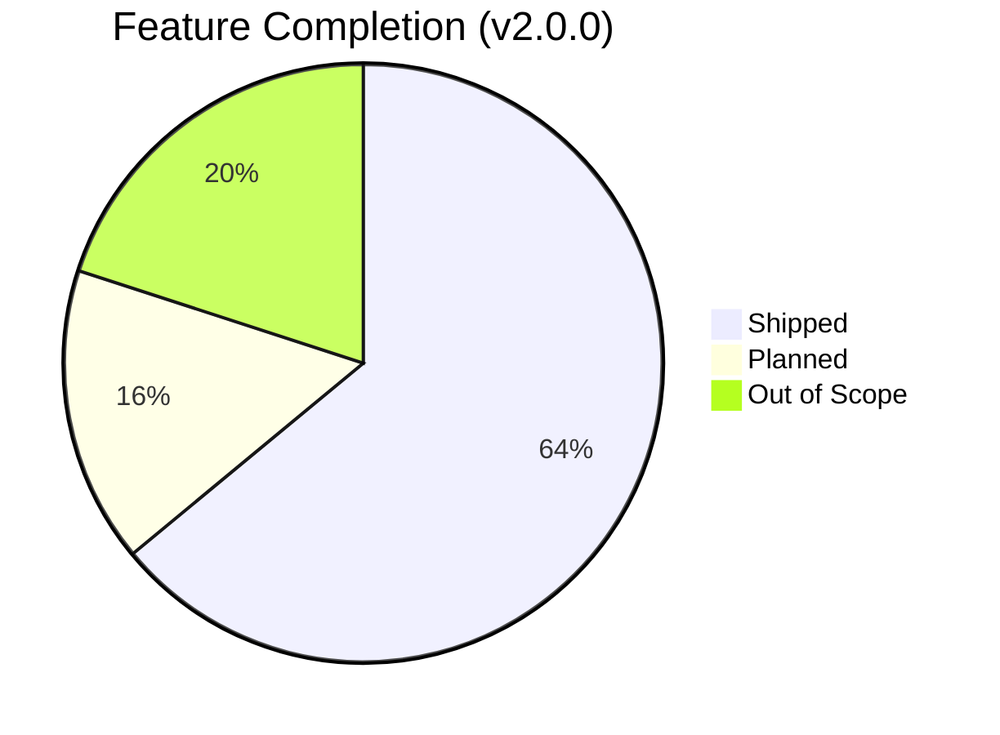
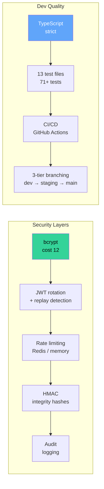

# Feature Roadmap

> Last updated: 2026-06-21 · v2.0.0

FinVault vs. a real retail banking app (Revolut / N26 / KBC-class).

---

## Feature Matrix

### Shipped Features

| # | Feature | Status | PR |
|---|---|---|---|
| 1 | Multi-wallet banking (checking/savings/travel) | ✅ Shipped | Core |
| 2 | P2P transfers (email + IBAN) | ✅ Shipped | Core |
| 3 | SEPA transfers with XML validation | ✅ Shipped | Core |
| 4 | Card management (freeze, limits, controls) | ✅ Shipped | #65 |
| 5 | Savings goals with funding + progress | ✅ Shipped | Core |
| 6 | Spend analytics (categories, trends, charts) | ✅ Shipped | Core |
| 7 | QR scan-to-pay (EPC069-12 SEPA standard) | ✅ Shipped | #44 |
| 8 | Biometric authentication (Face ID / fingerprint) | ✅ Shipped | #45 |
| 9 | CSV statement export (web download + mobile share) | ✅ Shipped | #36 |
| 10 | Beneficiary management (auto-save on transfer) | ✅ Shipped | #42 |
| 11 | Scheduled & recurring payments | ✅ Shipped | #68 |
| 12 | Budgets with category limits + alerts | ✅ Shipped | #68 |
| 13 | FX currency exchange (10 currencies) | ✅ Shipped | #68 |
| 14 | Notification center with persistence | ✅ Shipped | #68 |
| 15 | Security center (password, sessions) | ✅ Shipped | #68 |
| 16 | Dispute flow (report transactions) | ✅ Shipped | #68 |

### Planned

| # | Feature | Priority | Status |
|---|---|---|---|
| 17 | TOTP 2FA | P2 | Placeholder in Security Center |
| 18 | Scheduled payment executor (cron) | P2 | Backend model ready |
| 19 | Push notifications (FCM) | P3 | Notification center ready |
| 20 | iOS App Store build | P3 | EAS config ready |

### Intentionally Out of Scope

| Feature | Reason |
|---|---|
| Real payment rails (SWIFT, SEPA SCT) | Demo project — mock transactions |
| Joint accounts | Complexity without demo value |
| Lending products / mortgages | Different domain |
| Investment / trading | Different domain |
| KYC identity verification | Would need real ID providers |

---

## Architecture Quality

---

## Comparison vs. Banking Apps

| Category | Revolut | N26 | FinVault |
|---|---|---|---|
| Multi-currency wallets | ✅ | ✅ | ✅ |
| P2P transfers | ✅ | ✅ | ✅ (email + IBAN) |
| QR payments | ✅ | ❌ | ✅ (EPC069-12) |
| Card controls | ✅ | ✅ | ✅ |
| Savings goals | ✅ | ✅ | ✅ |
| Round-up savings | ✅ | ✅ | ✅ |
| Budgets | ✅ | ✅ | ✅ |
| FX exchange | ✅ | ❌ | ✅ (mock rates) |
| Scheduled payments | ✅ | ✅ | ✅ |
| Biometric login | ✅ | ✅ | ✅ |
| Disputes | ✅ | ✅ | ✅ |
| Notifications | ✅ | ✅ | ✅ |
| CSV export | ✅ | ✅ | ✅ |
| 2FA (TOTP) | ✅ | ✅ | 🔜 Planned |
| Push notifications | ✅ | ✅ | 🔜 Planned |
| Real payment rails | ✅ | ✅ | ❌ Demo only |
| Crypto trading | ✅ | ❌ | ❌ Out of scope |
