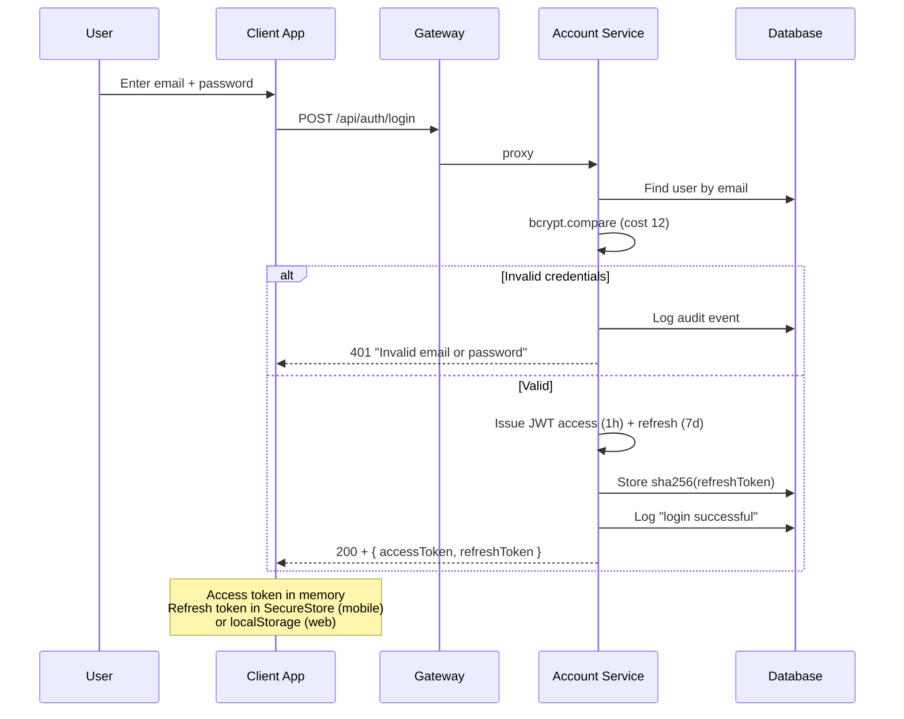
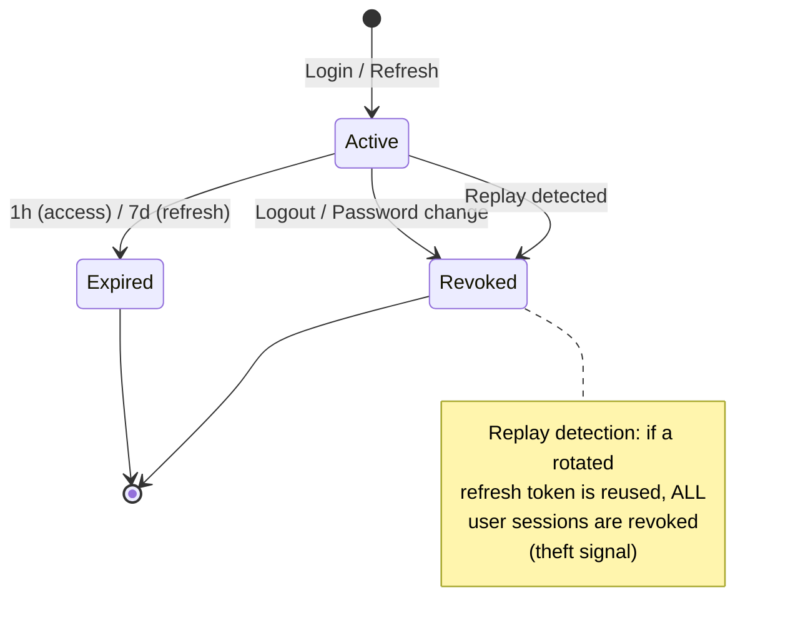
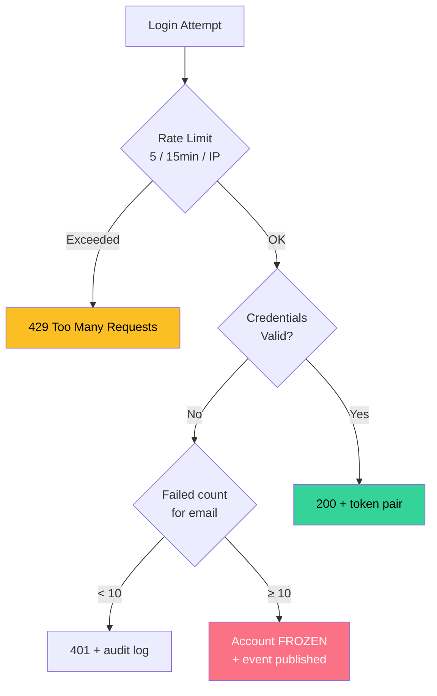
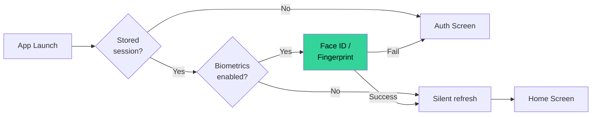
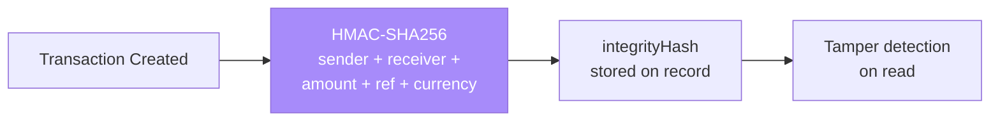

# FinVault Security

> Last updated: 2026-06-21 · v2.0.0

Security posture of the platform and the reasoning behind each layer.

---

## Authentication Flow

---

## Token Lifecycle

| Mechanism | Detail |
|---|---|
| **Password hashing** | bcrypt, cost factor **12** |
| **Password policy** | ≥ 8 chars, upper + lower + digit (Zod `RegisterSchema`) |
| **Access token** | JWT, **1 hour**, signed with `JWT_SECRET` |
| **Refresh token** | JWT, **7 days**, stored **sha256-hashed** in `RefreshToken` table |
| **Rotation** | `/auth/refresh` revokes the used token and issues a new pair |
| **Replay detection** | Replaying a rotated token revokes **all** of that user's sessions |
| **Revocation** | `/auth/logout` marks the refresh token as revoked (idempotent, audited) |
| **Password change** | `/users/change-password` revokes all sessions, issues fresh pair |
| **Session management** | `/users/sessions` lists active tokens; `DELETE /:id` revokes one |

---

## Account Protection

| Protection | Config |
|---|---|
| Login rate limit | 5 attempts / 15 min / IP |
| Registration rate limit | 3 accounts / hour / IP |
| Gateway rate limit | 500 requests / min / IP (Redis or in-memory) |
| Account lockout | 10 failed logins → account frozen + `account.frozen` event |
| Error hygiene | Generic "Invalid email or password" — no account-existence or attempt-count leak |

---

## Client Storage

| Platform | Access Token | Refresh Token | Theme Prefs |
|---|---|---|---|
| **Mobile** | In memory (`useState`) | iOS Keychain / Android Keystore (`expo-secure-store`) | SecureStore |
| **Web** | In memory (`useState`) | `localStorage` (`fv_refresh`) | `localStorage` (`fv_theme`) |

### Mobile Biometrics

- `expo-local-authentication` for Face ID / fingerprint
- Opt-in preference stored in keystore
- First-login prompt (#62) — dismissed state persisted so it only asks once
- Settings toggle for enable/disable

---

## Service-to-Service Trust

| Mechanism | Where Used |
|---|---|
| `X-Service-Secret` header | `/users/profile-by-email`, `/transactions/internal-transfer`, Event Hub |
| Loud dev-fallback warnings | `shared/auth.ts` logs warnings when `JWT_SECRET` / `SERVICE_SECRET` use built-in values |

---

## Data Integrity

- Each transaction stores an HMAC integrity hash (`FINVAULT_MESSAGE_KEY`)
- All auth events logged in `AuditLog` with IP and user agent
- Transfers run inside Prisma `$transaction` blocks
- SEPA IBANs are format-validated (structurally valid, not mod-97 checksummed for demo IBANs)

---

## Transport & Headers

- Every service runs `helmet()` (security headers)
- Gateway CORS: open in local demo; set `CORS_ORIGINS` to enforce an allowlist
- JSON bodies capped at 1 MB
- WebSocket connections authenticate JWT before registration

---

## Demo Mode

When the backend is unreachable, both apps fall back to a purely client-side demo session (`mock-token`) with fabricated data. Nothing in demo mode talks to a server, and the mock token is never accepted by any service.

---

## Known Gaps

| Gap | Risk | Mitigation |
|---|---|---|
| Web refresh token in `localStorage` | XSS can read it | Rotation + replay-revocation limit blast radius; httpOnly cookie would fully eliminate |
| No TOTP 2FA | Account takeover with stolen password | Planned (#30); biometrics cover mobile |
| Card PAN/CVV in plaintext | N/A for demo data | Never store real card data this way (PCI scope) |
| Account freeze has no self-unfreeze | UX friction | By design — support-only unfreeze |
| SecureStore not hardware-encrypted | Token accessible without biometric prompt | Needs dev build for `requireAuthentication` option |
