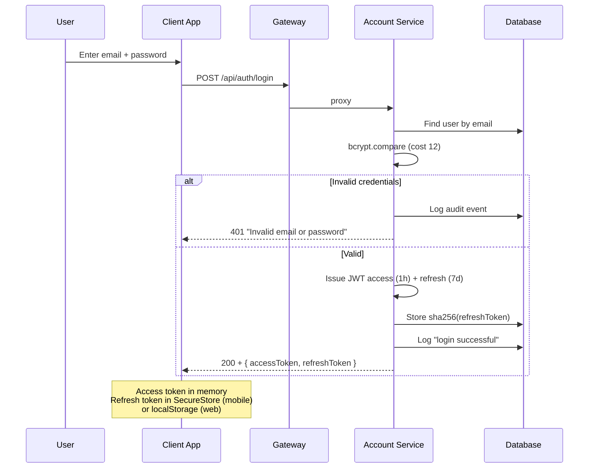
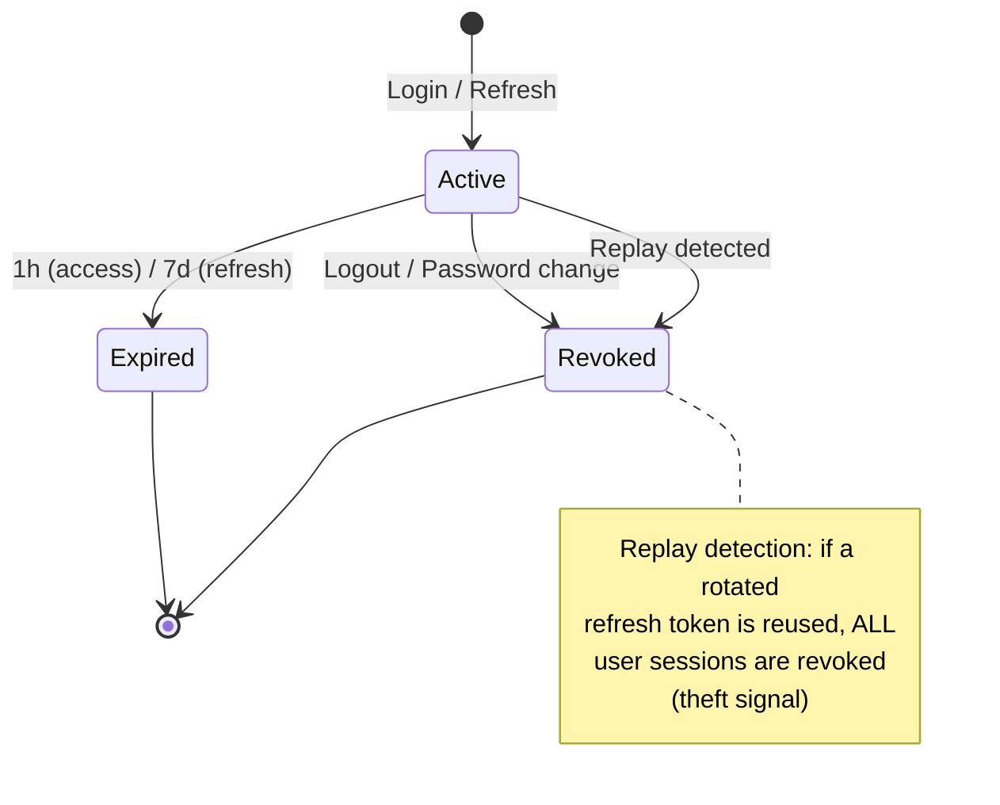
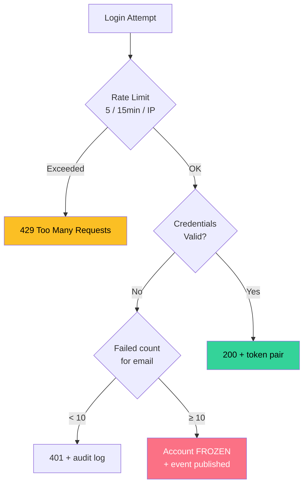
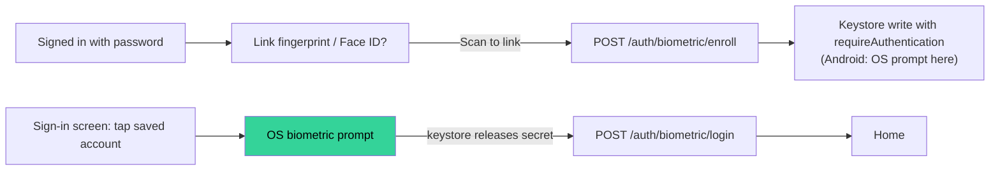

# FinVault Security

> Last updated: 2026-06-21 · v2.0.0

Security posture of the platform and the reasoning behind each layer.

---

## Authentication Flow

---

## Token Lifecycle

| Mechanism | Detail |
|---|---|
| **Password hashing** | bcrypt, cost factor **12** |
| **Password policy** | ≥ 8 chars, upper + lower + digit (Zod `RegisterSchema`) |
| **Access token** | JWT, **1 hour**, signed with `JWT_SECRET` |
| **Refresh token** | JWT, **7 days**, stored **sha256-hashed** in `RefreshToken` table |
| **Rotation** | `/auth/refresh` revokes the used token and issues a new pair |
| **Replay detection** | Replaying a rotated token revokes **all** of that user's sessions |
| **Revocation** | `/auth/logout` marks the refresh token as revoked (idempotent, audited) |
| **Password change** | `/users/change-password` revokes all sessions, issues fresh pair |
| **Session management** | `/users/sessions` lists active tokens; `DELETE /:id` revokes one |

---

## Account Protection

| Protection | Config |
|---|---|
| Login rate limit | 5 attempts / 15 min / IP |
| Registration rate limit | 3 accounts / hour / IP |
| Gateway rate limit | 500 requests / min / IP (Redis or in-memory) |
| Account lockout | 10 failed logins → account frozen + `account.frozen` event |
| Error hygiene | Generic "Invalid email or password" — no account-existence or attempt-count leak |

---

## Client Storage

| Platform | Access Token | Refresh Token | Theme Prefs |
|---|---|---|---|
| **Mobile** | In memory (`useState`) | iOS Keychain / Android Keystore (`expo-secure-store`) | SecureStore |
| **Web** | In memory (`useState`) | `localStorage` (`fv_refresh`) | `localStorage` (`fv_theme`) |

### Mobile biometrics and saved accounts (#121)

- **Per account, per phone.** `src/accounts.ts` keeps the saved-accounts list
  (`finvault.accounts`: name, email, whether biometrics are linked; no secrets) and one
  device credential per account (`finvault.bio.<email>`), stored with
  `requireAuthentication`: the keystore key needs the OS biometric prompt for every
  read (and, on Android, for the write, which is the "scan to link" moment).
  Android invalidates the key when a new fingerprint is added; the app then unlinks the
  account and asks for the password.
- **Fallback:** where hardware binding is unavailable (Expo Go on iOS, devices
  without strong biometrics) the secret is only keystore-encrypted and the app shows the
  OS prompt itself before reading it. `hardwareBindingAvailable()` decides.
- **Device PIN is not accepted** as a biometric (`disableDeviceFallback`).
- **Launch:** a stored session for an account with biometrics linked is unlocked only
  after the OS prompt; otherwise the app opens on the account list.
- **Switching** signs out of the current account (refresh token revoked) and into the
  other: with its biometrics when linked, otherwise the password form opens with its
  email filled in. Signing out keeps the account (and its link) in the list; "Remove
  from this phone" deletes the local credential. The server entry stays until the
  password changes or the phone is unlinked in **Security Center → Biometric sign-in**,
  which lists every linked phone (name, linked, last used) and marks this one (#124).
- A password change unlinks every phone on the server, and the app clears its own
  local credential to match.
- Unlinking in Settings deletes the server device and the local credential; cancelling
  the link scan withdraws the credential the server just issued.

### Biometric device binding (server, #120)

Neither the server nor the app ever sees a fingerprint or a face: Android and iOS
keep the biometric templates and only report "the enrolled owner passed". What can be
bound is the **phone**:

1. Signed in with a password, the user enables biometrics. `POST /auth/biometric/enroll`
   (access token) issues a random 256-bit device secret, once, and stores only its
   SHA-256 in `BiometricDevice`.
2. The app keeps `{deviceId, secret}` in the hardware keystore, unlockable only through
   the OS biometric prompt.
3. Signing in: biometric prompt → keystore releases the secret →
   `POST /auth/biometric/login {deviceId, secret}` → a normal token pair.

- Wrong secret and unknown device get the same 401 (no enumeration); 10 attempts per IP
  per 15 min; frozen accounts are refused; every enrollment, sign-in and removal is audit-logged.
- The device acts as the second factor, so TOTP is not asked again on biometric sign-in.
- `GET /users/biometric-devices` lists enrolled phones (never the hash);
  `DELETE /users/biometric-devices/:id` revokes one (own devices only).
- Changing the password deletes every enrolled device; phones re-enroll after the next
  password sign-in.

---

## Known Gaps

| Gap | Risk | Mitigation |
|---|---|---|
| Web refresh token in `localStorage` | XSS can read it | Rotation + replay-revocation limit blast radius; httpOnly cookie would fully eliminate |
| No TOTP 2FA | Account takeover with stolen password | Planned (#30); biometrics cover mobile |
| Card PAN/CVV in plaintext | N/A for demo data | Never store real card data this way (PCI scope) |
| Account freeze has no self-unfreeze | UX friction | By design — support-only unfreeze |
| Session refresh token not biometric-locked | The active session's refresh token is keystore-encrypted but readable without a prompt (the app-level prompt gates it on launch) | Biometric *sign-in* credentials are hardware-bound (#121); locking the session token too would prompt on every refresh |
